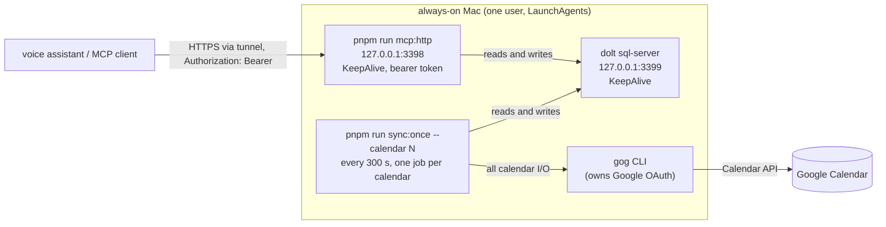

# Always-on hosting (a launchd service on an always-on Mac)

Design and runbook for keeping the service up on one Mac that stays on. Nothing here
runs in the cloud, and nothing here has been installed on a real host: the plists are
generated and linted (`plutil -lint`), the wrapper that sources gog's env file was run,
and the install steps below are **not yet executed**. See `docs/live-punch-list.md`
for what is verified and what still needs the owner.

## Shape



- **The tools never touch a calendar.** Only `sync:once` does, and only through gog.
- **One Dolt server per service**, on its own port and data directory. This is not the
  fleet-shared Dolt on 3307; migrating the fleet server is a human-paused action in
  `AGENTS.md`.
- **LaunchAgents, not LaunchDaemons**, in the owner's login session. gog keeps its
  tokens in a file keyring on this setup (the macOS keychain is locked for unattended
  use), and a daemon would not see the owner's home directory configuration.
- **Sync is interval-scheduled, not a long-running loop.** Each run is one
  `sync:once`, which already holds the cursor on a partial failure and exits non-zero.
  A run that overlaps the next is skipped by launchd, which will not start a job
  that is still running.

## Prerequisites on the host

| Need | Check |
|---|---|
| node, pnpm | `node --version && pnpm --version` |
| dolt | `dolt version`, and an identity: `dolt config --global --add user.name "brain-calendar" && dolt config --global --add user.email "brain-calendar@localhost"` |
| gog signed in to the account | `gog auth list --check`. **A one-time browser consent by the owner**; see below. |
| gog's keyring variables | `~/.config/gog/env` exporting `GOG_KEYRING_BACKEND` and `GOG_KEYRING_PASSWORD` (mode 600) |
| a checkout of this repo | `git clone https://github.com/trillium/brain-calendar-service.git` then `pnpm install --frozen-lockfile` |
| the Mac does not sleep | System Settings > Energy, or `sudo pmset -a sleep 0` (owner's call) |

No new OAuth client or Google account is created: gog already holds the Google
credentials. If the always-on Mac is not the machine gog was authorised on, gog must
be authorised there once (`gog auth add <address>`, a browser flow only the owner can
complete) unless the existing credentials can be made available to gog on that host.

## Install

Pick the values once.

```sh
export REPO=~/brain-calendar-service
export ACCOUNT=you@example.com
mkdir -p ~/Library/Logs/brain-calendar "$HOME/Library/Application Support/brain-calendar/dolt"
umask 077 && mkdir -p ~/.config/brain-calendar \
  && openssl rand -hex 32 > ~/.config/brain-calendar/mcp-token
```

Generate the plists. The default is **read-only**: sync jobs run `sync:once --dry-run`.

```sh
cd "$REPO"
pnpm run launchd:gen --out ~/brain-calendar-launchd --account "$ACCOUNT" \
  --token-file ~/.config/brain-calendar/mcp-token --calendar <registered calendar id>
for f in ~/brain-calendar-launchd/*.plist; do plutil -lint "$f"; done
```

`launchd:gen` flags: `--out` and `--account` and `--token-file` are required; `--calendar`
repeats (one sync job each); `--repo`, `--bin-dir` (repeats; where node, pnpm, dolt and
gog live), `--dolt-data-dir`, `--dolt-port` (3399), `--mcp-port` (3398), `--gog-env-file`,
`--log-dir`, `--interval` (300, minimum 60), `--label-prefix` (`com.brain-calendar`), and
`--live`.

Install in order. Dolt first, then create the schema, then the rest.

```sh
cp ~/brain-calendar-launchd/com.brain-calendar.dolt.plist ~/Library/LaunchAgents/
launchctl bootstrap "gui/$(id -u)" ~/Library/LaunchAgents/com.brain-calendar.dolt.plist
CALENDAR_DB_PORT=3399 pnpm run db:migrate && CALENDAR_DB_PORT=3399 pnpm run db:verify
cp ~/brain-calendar-launchd/com.brain-calendar.mcp.plist ~/Library/LaunchAgents/
launchctl bootstrap "gui/$(id -u)" ~/Library/LaunchAgents/com.brain-calendar.mcp.plist
curl -s localhost:3398/healthz      # {"ok":true}
```

Register each calendar before its sync job exists (the live path refuses an unregistered
one), then install its job:

```sh
CALENDAR_DB_PORT=3399 pnpm run calendar:register --remote-id <google calendar id> --name <label>
cp ~/brain-calendar-launchd/com.brain-calendar.sync.<n>.plist ~/Library/LaunchAgents/
launchctl bootstrap "gui/$(id -u)" ~/Library/LaunchAgents/com.brain-calendar.sync.<n>.plist
```

## Going live (writes to a calendar)

Dry-run sync jobs only read and plan. Letting a job write to a calendar is the same
decision as `docs/running-by-hand.md` step 6 and the SyncPolicy allowlist: only for a
calendar the owner has named. When that is decided, regenerate with `--live`, replace the
plist, and `launchctl bootout` then `bootstrap` the job. Run the soak run first.

## Operate

| Task | Command |
|---|---|
| Is it loaded and running | `launchctl print "gui/$(id -u)/com.brain-calendar.mcp" \| head` |
| Logs | `~/Library/Logs/brain-calendar/{dolt,mcp,sync-<n>}.{out,err}.log` |
| Restart one | `launchctl kickstart -k "gui/$(id -u)/com.brain-calendar.mcp"` |
| Stop and remove one | `launchctl bootout "gui/$(id -u)/com.brain-calendar.sync.<n>"` then delete its plist |
| Rotate the MCP token | write a new `mcp-token`, then `kickstart -k` the mcp job |

## Reaching it from elsewhere

The MCP server binds loopback and speaks plain HTTP; the bearer token authenticates but
does not encrypt (see `docs/mcp-auth.md`). A client on another machine needs a tunnel or
reverse proxy that terminates TLS and forwards to `127.0.0.1:3398`. Choosing and
running that is an owner decision, not something this repo configures.

## Known gaps

- **Live sync rounds append to `evidence/soak/report.json` inside the checkout**, so a
  host checkout that syncs live will show a modified tracked file. Do not `git pull` over it
  without stashing or committing it, or keep the host checkout on a branch that expects it.
- **No backup of the Dolt data directory** is configured. The history is the audit trail;
  a `dolt backup` or a periodic copy of the data directory is a decision for the owner.
- **No alerting.** A failed sync exits non-zero into its `.err.log` and launchd tries
  again at the next interval; nothing tells a human.
- **No auto-update.** Deploying a new version is `git pull`, `pnpm install --frozen-lockfile`,
  `db:migrate`, then `kickstart -k` the jobs.

## Checked by

`src/hosting/launchd.test.ts`: the job set, the read-only default, that no secret appears
in a plist, loopback binding, argv[0] resolution, scheduling, input validation, XML
escaping, and `plutil -lint` on every generated plist (macOS only).
